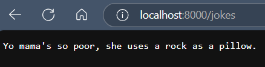

# yomama jokes api

because why not?  
a simple go api built with fiber that serves up random yo mama jokes, one at a time.  
perfect for when you need a laugh or just wanna roast your friends.

---

## how it works

- `/jokes`: returns a random yo mama joke from the collection.  
- `/ping`: just a health check endpoint. responds with "pong".  

---

## why this exists

because i was learning go and thought, "what's better than building an api?"  
answer: building an api that delivers quality roasts.

---

## screenshot

here's how the `/jokes` endpoint looks in action:  


---

## run it locally

1. make sure you have go installed.  
2. clone this repo:  
   ```bash
   git clone https://github.com/aadithyanr/yomama-jokes-api.git
   cd yomama-jokes-api
   ```
3. install dependencies:  
   ```bash
   go mod tidy
   ```
4. run the server:  
   ```bash
   go run main.go
   ```
5. visit `http://localhost:8000/jokes` to get roasted.  

---

## jokes sauce

all jokes are stored in `jokes/jokes.txt`.  
feel free to add your own—just make sure each joke is on a new line.  

---

## license

nah, no license. just have fun. 
```

---